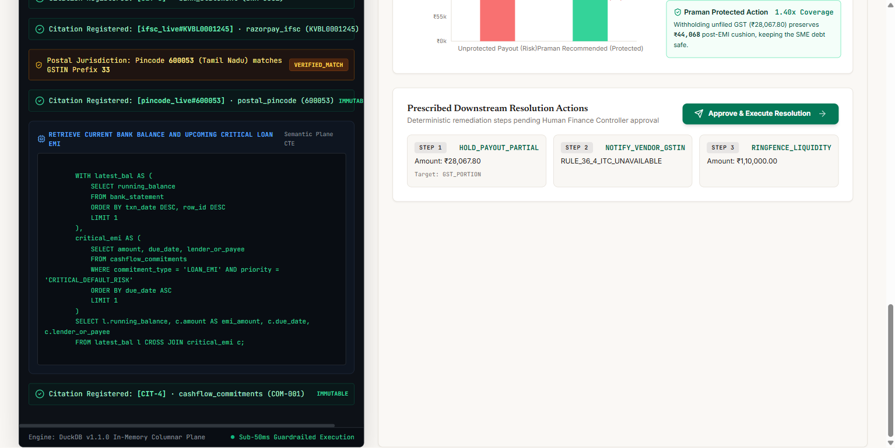

# Praman (प्रमाण)

> **The reconciliation layer for Indian SME finance.**  
> *AI reads and explains. Deterministic code decides.*

[](https://python.org)
[](https://fastapi.tiangolo.com)
[](https://duckdb.org)
[](https://vitejs.dev)
[-success.svg)](https://pytest.org)
[](#-quick-start)
[](#-how-it-works)

[How it works](#-how-it-works) · [The DuckDB Data Plane](#-the-duckdb--indic-udf-data-plane) · [Guardrails](#-guardrails--defensive-execution) · [Sources & Adapters](#-sources--live-adapters) · [Architecture](#-architecture) · [Quick start](#-quick-start) · [Quality](#-quality--verification)

[▶ Watch the <5 min Demo Video](YOUR_DEMO_LINK)

---

An SME accountant spends hours matching messy Indian bank narrations, Razorpay UPI dumps, Tally invoices, and GSTR-2B filings. **Praman** reconciles them in seconds, protects your 30-day EMI runway, and cites every rupee back to its exact database row.



---

## ⚡ How It Works

Praman uses a strict neuro-symbolic division of labor: **AI reads, normalizes, and explains unstructured evidence; deterministic code queries, validates, and computes financial math.**

| Stage | Name | What Happens | Core Mechanism |
| :--- | :--- | :--- | :--- |
| **1** | **Trigger** | Operator selects a 1-click canonical scenario, pastes raw bank SMS/narration, or drops a custom CSV bank statement. | `1-Click Scenarios` / `Unseen Input Sandbox` / CSV Upload |
| **2** | **Intake (AI Reads)** | Parses noisy SMS/narrations into structured parameters (`utr`, `amount`, `direction`, `vendor`, `invoice_id`) with local regex PII scrubbing. | Optional LLM (`GROQ`, `OPENROUTER`, `OPENAI`, `GEMINI`) + Offline Regex Fallback |
| **3** | **Investigate (Code Decides)** | Joins across bank statements, Razorpay UPI logs, Tally invoices, and GSTR-2B tax records in an embedded DuckDB instance. Cross-references live bank routing and postal jurisdiction. | DuckDB SQL + 4 Indic UDFs (`extract_utr`, `norm_indic_vendor`, `jw_sim`, `validate_gstin_checksum`) + Razorpay IFSC & India Post APIs |
| **4** | **Brief & Guardrails** | Intercepts arithmetic hallucinations; calculates deterministic 30-day EMI debt-service ratios; builds an audit checklist; verifies every single rupee figure in the plain-English memo against computed values. | `sqlglot` AST Interceptor + `cashflow_math.py` + Memo Rupee Verifier |
| **5** | **Approve** | Delivers an editorial executive brief with clickable evidence chips (`[1]`, `[2]`, `[3]`). Operator executes a 1-click split payout (e.g., release principal, hold unfiled GST). | Human-in-the-Loop Execution (`POST /api/cases/{id}/approve`) |

---

## 🦆 The DuckDB + Indic UDF Data Plane

### Why an In-Process OLAP Data Plane?
Enterprise financial data in India is fragmented across disparate schemas: bank narrations are noisy free-text, UPI dumps record gateway-level RRNs, Tally holds ERP accruals, and GSTR-2B reflects monthly government filings.

Instead of writing fragile multi-hop Python loops that pull records into memory, Praman joins all 6 financial tables **directly inside an embedded DuckDB engine**:
- **Sub-15ms Analytical Queries**: Columnar vectorized processing evaluates joins and window functions across 10,000+ rows instantly.
- **Embedded In-Process Memory**: Zero database network latency, zero external database setup, and zero cloud hosting cost.
- **Native Python UDF Integration**: Pure Python string-matching and checksum algorithms execute in-engine without serialization overhead.

### Real Abridged 3-Way Reconciliation Query

```sql
WITH target_invoice AS (
    SELECT invoice_id, invoice_date, vendor_name, vendor_gstin,
           taxable_value, igst_amount, total_amount, vendor_ifsc
    FROM tally_invoices
    WHERE invoice_id = 'INV-2026-104'
),
bank_candidates AS (
    SELECT b.row_id, b.txn_date, b.narration, b.ifsc_code, b.withdrawal,
           extract_utr(b.narration) AS extracted_utr,
           norm_indic_vendor(v.vendor_name) AS clean_target_vendor,
           jw_sim(b.narration, norm_indic_vendor(v.vendor_name)) AS sim_score
    FROM bank_statement b
    CROSS JOIN target_invoice v
    WHERE b.ifsc_code = v.vendor_ifsc
      AND jw_sim(b.narration, norm_indic_vendor(v.vendor_name)) >= 0.90
    -- Deduplicate look-alike phonetic decoys by keeping top similarity match
    QUALIFY ROW_NUMBER() OVER (
        PARTITION BY b.ifsc_code 
        ORDER BY sim_score DESC
    ) = 1
),
tax_filing AS (
    SELECT gstr2b_id, gstin_supplier, invoice_num, itc_eligible_amount, filing_status
    FROM gstr2b_tax
    WHERE invoice_num = 'INV-2026-104'
)
SELECT 
    v.invoice_id,
    v.vendor_name,
    v.total_amount,
    v.igst_amount AS gst_at_risk,
    b.row_id AS matched_bank_row,
    b.extracted_utr,
    b.sim_score,
    COALESCE(t.itc_eligible_amount, 0.0) AS itc_eligible,
    COALESCE(t.filing_status, 'NOT_FILED') AS gstr2b_filing_status
FROM target_invoice v
LEFT JOIN bank_candidates b ON 1=1
LEFT JOIN tax_filing t ON v.invoice_id = t.invoice_num;
```

---

## 🛡️ Guardrails & Defensive Execution

Praman intercepts hazardous SQL queries and hallucinated arithmetic before anything touches the ledger or reaches the CFO:

### 1. `sqlglot` AST Semantic Guardrail
Generic LLMs frequently produce hazardous accounting queries—most notoriously `SUM(running_balance)`, which creates astronomical false cash totals by summing snapshot state. 

Praman parses all incoming SQL into an Abstract Syntax Tree via `sqlglot.parse(sql, read="duckdb")`:
- **Recursive CTE & Subquery Alias Tracking**: Traces column aliases back to their origin (e.g., `WITH cte AS (SELECT running_balance AS rb FROM bank_statement) SELECT SUM(rb) FROM cte` maps `rb` directly to `running_balance`).
- **Deep Expression Inspection**: Walks every `exp.Sum` AST node and recursively scans all child `exp.Column` nodes, catching `SUM(COALESCE(running_balance, 0))`, `SUM(CAST(running_balance AS DOUBLE))`, and wrapped arithmetic expressions.
- **Blocks Invalid Aggregations**: Raises `SqlSemanticError` whenever `SUM(running_balance)` is attempted, forcing queries to use closing balance window semantics (`ORDER BY txn_date DESC, row_id DESC LIMIT 1`).
- *Note:* Legitimate metrics like `AVG(running_balance)` (average daily ledger balance calculation) remain permitted.

### 2. Cartesian Fanout Interceptor
Indian vendor directories feature frequent phonetic look-alikes (`Sri Balaji Enterprises`, `Balaji Traders`, `Shree Balaji Packaging`). Naive SQL queries (`LIKE '%Balaji%'` or unrestricted fuzzy joins $< 0.90$) trigger severe Cartesian fanouts. Praman intercepts fuzzy joins missing window partitions, raising similarity thresholds to $\ge 0.92$ and enforcing `QUALIFY ROW_NUMBER() OVER (...) = 1`.

### 3. Exact Rupee Memo Verification
Before presenting an executive memo, Praman runs a post-synthesis verification pass: every `₹` amount mentioned in the prose is extracted and compared against the deterministic values computed by `cashflow_math.py`. If a figure deviates by more than ₹1.00, the memo is rejected and regenerated from verified facts.

---

## 📦 Sources & Live Adapters

### 1. Embedded DuckDB Ledger Tables (10,040 Synthetic Rows)
*All rows are deterministically generated synthetic data calibrated to match real Indian SME banking patterns.*

| Table | Rows | Primary Fields | Accounting Invariant Verified |
| :--- | :---: | :--- | :--- |
| `bank_statement` | **4,000** | `row_id`, `txn_date`, `narration`, `withdrawal`, `deposit`, `running_balance`, `ifsc_code` | Strictly positive running balance (₹2.5L to ₹18.5L), mutually exclusive withdrawal/deposit, closing balance ₹3,12,450.00. |
| `razorpay_upi` | **2,500** | `payment_id`, `order_id`, `gross_amount`, `mdr_fee`, `net_settlement`, `status`, `rrn_utr`, `customer_vpa` | **Zero MDR mandate** (`mdr_fee = 0.0`, `net_settlement = gross_amount`). Reconciles against bank statement settlements via 12-digit RRN/UTR. |
| `tally_invoices` | **1,800** | `invoice_id`, `invoice_date`, `vendor_name`, `vendor_gstin`, `taxable_value`, `igst_amount`, `total_amount`, `payout_status` | Three-way match ready against GSTR-2B tax entries and bank disbursements. |
| `gstr2b_tax` | **1,700** | `gstr2b_id`, `gstin_supplier`, `invoice_num`, `itc_eligible_amount`, `filing_status` | CGST Section 16(2)(aa) statutory reflection baseline (`FILED` vs `NOT_FILED`). |
| `cashflow_commitments`| **25** | `commitment_id`, `due_date`, `amount`, `commitment_type`, `priority`, `lender_or_payee` | Prioritized debt-service schedule (e.g., HDFC Business Loan EMI ₹1,10,000.00 due 2026-11-25). |
| `company_policies` | **15** | `policy_id`, `domain`, `title`, `rule_body`, `section_ref` | Statutory tax withholding rules and liquidity reserve thresholds. |

### 2. Live Keyless Public APIs (With Offline Cache Fallback)
*All external API calls run with 3.0s timeouts and instant offline fallback caches so Praman works with zero internet access.*

| Endpoint URL | Auth | Purpose | Fallback Behavior |
| :--- | :---: | :--- | :--- |
| `https://ifsc.razorpay.com/{ifsc}` | `None` | Resolves live bank branch name, city, state, MICR, and NEFT/RTGS/UPI enablement. | Offline RBI Master IFSC cache. |
| `https://api.postalpincode.in/pincode/{pin}` | `None` | Cross-verifies vendor postal state against 2-digit GSTIN state prefix (`33` = TN, `27` = MH, `29` = KA). | Static India Post State Map. |
| `https://api.frankfurter.app/latest?from=USD&to=INR`| `None` | Fetches live USD/INR exchange rate for FX-pegged software and cloud infrastructure contracts. | Fixed RBI reference rate (`₹84.00/USD`). |
| `https://api.xposedornot.com/v1/check-email/{email}` | `None` | Screens vendor billing email addresses for Business Email Compromise (BEC) breaches. | Conservative manual review flag. |

---

## 🏛️ Architecture

```
                           PRAMAN SYSTEM ARCHITECTURE
  
 ┌────────────────────────────────────────────────────────────────────────┐
 │                               PRAMAN UI                                │
 │          (Editorial Financial Dossier · React 18 + Vite + Tailwind)    │
 │  ┌─────────────────────────────────┐  ┌─────────────────────────────┐  │
 │  │    Obsidian SQL & UDF Feed      │  │ Cited Executive Brief Memo  │  │
 │  │  • Real-time SSE reasoning trace│  │  • Numbered citations [1][2]│  │
 │  │  • Self-healing query observer  │  │  • 30-day EMI runway widget │  │
 │  │  • Live bank routing / IFSC card│  │  • 1-click split payout CTA │  │
 │  └────────────────▲────────────────┘  └──────────────▲──────────────┘  │
 └───────────────────┼──────────────────────────────────┼─────────────────┘
                     │ Server-Sent Events (SSE)         │ REST / Actions
 ┌───────────────────┴──────────────────────────────────┴─────────────────┐
 │                         PRAMAN FASTAPI BACKEND                         │
 │                                                                        │
 │   ┌────────────────────────────────────────────────────────────────┐   │
 │   │                           AI LAYER                             │   │
 │   │  • Intake Parsing: Noisy SMS/narration -> JSON (PII Redacted)  │   │
 │   │  • Dossier Synthesis: Table facts -> Plain-English Brief       │   │
 │   │  • Multi-Provider: Groq, OpenRouter, OpenAI, Gemini, or Offline│   │
 │   │  • Rupee Verifier: Asserts 100% parity between text and math   │   │
 │   └────────────────▲──────────────────────────────▲────────────────┘   │
 │                    │                              │                    │
 │   ┌────────────────┴──────────────────────────────┴────────────────┐   │
 │   │                      DETERMINISTIC CORE                        │   │
 │   │  ┌──────────────────────────────┐ ┌──────────────────────────┐ │   │
 │   │  │   DuckDB Semantic Plane      │ │  Deterministic Math      │ │   │
 │   │  │  • 10,040 rows in 6 tables   │ │  • Zero mental arithmetic│ │   │
 │   │  │  • sqlglot AST guardrail     │ │  • cashflow_math.py      │ │   │
 │   │  │  • 4 pure Indic Python UDFs  │ │  • Exact EMI coverage    │ │   │
 │   │  └─────────────▲────────────────┘ └────────────▲─────────────┘ │   │
 │   │                │                               │               │   │
 │   │  ┌─────────────┴───────────────────────────────┴─────────────┐ │   │
 │   │  │              Live Public Adapters (Keyless)               │ │   │
 │   │  │  • Razorpay IFSC       • India Post Pincode               │ │   │
 │   │  │  • Frankfurter FX      • XposedOrNot Breach Check         │ │   │
 │   │  └───────────────────────────────────────────────────────────┘ │   │
 │   └────────────────────────────────────────────────────────────────┘   │
 └────────────────────────────────────────────────────────────────────────┘
```

---

## ⚡ The 4 Canonical Scenarios

1. **Scenario 1: Missing GSTR-2B ITC Hold (`CASE-GST-104`)**  
   Sri Balaji Enterprises invoice `INV-2026-104` (₹1,84,000.00) matches Tally ERP, but GSTR-2B shows `NOT_FILED`. Paying the full invoice before filing puts **₹28,067.80 GST credit at risk** under Section 16(2)(aa) of the CGST Act, 2017, and drops post-EMI cash buffer to ₹18,450 ahead of a ₹1,10,000 HDFC loan EMI due 2026-11-25 (**1.17x EMI coverage**). Praman recommends: *Hold ₹28,067.80 GST, release ₹1,55,932.20 principal, preserving 1.42x EMI coverage.*

2. **Scenario 2: UPI Switch Double-Debit Dispute (`CASE-UPI-209`)**  
   Customer reported ₹14,500 double-debit. Gateway logs prove Attempt 1 failed at the bank switch node, while Attempt 2 settled to merchant account under `HDFC0000240`. Praman rejects merchant refund and transmits NPCI switch failure proof for automatic bank reversal.

3. **Scenario 3: B2B SLA Downtime Pro-Rata Credit (`CASE-SLA-302`)**  
   CloudSphere Infrastructure invoice `INV-2026-881` (₹84,000.00). System outage breached 99.5% uptime commitment. Policy `POL-SLA-01` (`SEC-4.2`) mandates a pro-rata service credit of ₹5,600.00 via debit note rather than full refund. Praman issues Debit Note `DN-2026-881` and approves net payout of ₹78,400.00.

4. **Scenario 4: Split-Payment Duplicate Payout Risk (`CASE-DUP-404`)**  
   Apex Logistics invoice `INV-2026-404` (₹1,25,000.00). Marked `PENDING_APPROVAL` in ERP, yet bank statement reflects two split disbursements of ₹62,500.00 each against PO8921. Praman halts duplicate payout and freezes funds pending ledger verification.

---

## 🚀 Quick Start

### Prerequisites
- **Python**: `3.12+` (tested on Python 3.12 & 3.13)
- **Node.js**: `20+` (with `npm`)

### 1-Click Launch (Recommended)

#### On macOS / Linux / WSL:
```bash
git clone https://github.com/bhuvaneshmp/Praman-AI.git
cd Praman-AI
chmod +x start.sh
./start.sh
```

#### On Windows PowerShell:
```powershell
git clone https://github.com/bhuvaneshmp/Praman-AI.git
cd Praman-AI
powershell -ExecutionPolicy Bypass -File .\start.ps1
```

---

### Manual Setup (Step-by-Step)

#### 1. Backend Setup
```bash
# From repository root
python -m venv venv
source venv/bin/activate  # On Windows: .\venv\Scripts\Activate.ps1

pip install -r backend/requirements.txt

# Seed the 10,040-row DuckDB store (if not already seeded)
python backend/praman-data/seed_duckdb.py

# Launch FastAPI backend
export PYTHONPATH="$PWD/backend/src"  # On Windows PowerShell: $env:PYTHONPATH="$PWD\backend\src"
uvicorn praman_api.main:app --host 127.0.0.1 --port 8000
```

#### 2. Frontend Setup
```bash
# In a separate terminal
cd frontend
npm install
npm run dev
```

Open **`http://127.0.0.1:5173`** for the Editorial Landing Page or **`http://127.0.0.1:5173/workspace`** for the Live Workspace.  
FastAPI documentation is available at **`http://127.0.0.1:8000/docs`**.

> **Note on LLM API Keys:** Praman is built **offline-first**. All deterministic SQL queries, Indic UDF joins, AST guardrails, and cashflow runway math run with **zero API keys**. If you want live LLM generation for intake extraction and memo synthesis, copy `.env.example` to `.env` and provide any key (`GROQ_API_KEY`, `OPENROUTER_API_KEY`, `OPENAI_API_KEY`, or `GEMINI_API_KEY`).

---

## 🧪 Quality & Verification

Every pull request and commit is validated against comprehensive backend and frontend verification suites:

### 1. Pytest Suite (59/59 Passing)
```powershell
python -m pytest backend/tests/ -v
```
- **AST SQL Guardrails (`test_duckdb_plane.py`)**: Interception of `SUM(running_balance)`, `SUM(COALESCE(...))`, and aliased CTE variations.
- **Indic Financial UDFs (`test_udfs.py`)**: Precision checks on `extract_utr`, `norm_indic_vendor`, `jw_sim`, and GSTIN checksum verification.
- **Look-Alike Vendor Safety (`test_agent_engine.py`)**: Evaluates query plan against all 153 look-alike vendors to prove zero Cartesian fanouts.
- **Statement CSV Upload (`test_api_endpoints.py`)**: Validates 1,000-row statement reconciliation in under 3 seconds.
- **Public API Adapters (`test_public_apis.py`)**: Validates live IFSC branch resolution and postal state matching with offline fallback.

### 2. Frontend Type & Build Verification
```powershell
cd frontend
npm run build
```
- Verified with `tsc && vite build` (0 TypeScript errors, 0 lint warnings).

---

## 📂 Repository Structure

```
Praman-AI/
├── README.md                          # System Documentation & Technical Reference
├── start.sh                           # 1-Click Startup for macOS / Linux / WSL
├── start.ps1                          # 1-Click Startup for Windows PowerShell
├── vercel.json                        # Vercel Multi-Service Deployment Config
├── netlify.toml                       # Netlify Deployment Config
├── .env.example                       # Documented Keyless Configuration
├── backend/                           # FastAPI Backend & Neuro-Symbolic Engine
│   ├── pyproject.toml
│   ├── requirements.txt
│   ├── tests/                         # 59 Unit & Integration Tests
│   ├── praman-data/                   # 10,040 Synthetic Relational Rows & DuckDB
│   └── src/praman_api/
│       ├── main.py                    # FastAPI application initialization
│       ├── config.py                  # Pydantic settings & path resolution
│       ├── models.py                  # Pydantic schemas & response models
│       ├── engine/
│       │   ├── udfs.py                # 4 Indic UDFs (extract_utr, jw_sim, etc.)
│       │   └── duckdb_plane.py        # sqlglot AST guardrail & DuckDB plane
│       ├── agent/
│       │   ├── tools.py               # Tool catalog
│       │   ├── llm_planner.py         # Local PII redactor & SQL planner
│       │   └── loop.py                # Streaming investigation loop
│       ├── services/
│       │   ├── cashflow_math.py       # Deterministic EMI runway calculator
│       │   └── citations.py           # Evidence citation tracker
│       └── adapters/
│           └── public_apis.py         # 4 Keyless Public API adapters
└── frontend/                          # Vite + React 18 Frontend
    ├── package.json
    ├── vite.config.ts
    └── src/
        ├── App.tsx                    # Root routing & state orchestrator
        ├── pages/
        │   └── Landing.tsx            # Editorial Landing Page
        └── components/
            ├── Workspace.tsx          # 50/50 Split Workspace
            ├── LiveSqlFeed.tsx        # Obsidian SQL terminal feed
            ├── InvestigationBrief.tsx # Cited plain-English memo
            ├── RunwayWidget.tsx       # Recharts 30-day EMI runway chart
            └── UnseenInputSandbox.tsx # Bank SMS & CSV statement upload sandbox
```

---

*Built with precision for Arthaton 2026.*
